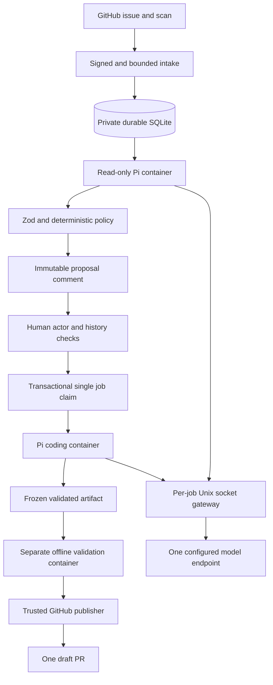

# Reina architecture and operations

## Boundaries

Probot receives signed webhooks and supplies Octokit and structured logging. The HTTP entrypoint
bounds payloads and removes issue/comment content before Probot dispatch. A synchronous SQLite
write precedes acknowledgement. An in-process dispatcher performs asynchronous work after intake.

Target content, model output, commands, and test output are untrusted. They cannot mint approvals,
alter job records, provide GitHub credentials, select publication destinations, or declare a patch
validated. The trusted worker calculates the diff and records the actual verification exit codes.

All untrusted execution uses non-root Linux containers with no network interface other than
loopback, a read-only root filesystem, no capabilities, no-new-privileges, and seccomp. The only
model connection is an exact per-job Unix socket mount. A trusted loopback bridge forwards to the
host gateway. The gateway adds the upstream key and accepts only the configured model endpoint.
Repository code can use the expiring job capability, subject to the same budgets as Pi.
Host Docker proxy variables are explicitly cleared so client configuration cannot inject proxy
credentials into a job. Startup probes verify this rule as well as the filesystem and process limits.

Triage uses a read-only snapshot mount. Coding uses a bounded disposable workspace volume.
Before export, the worker pauses the complete container, including detached children. The daemon
exports the frozen tree; the trusted parser rejects unsafe paths and unsupported file types.
A fresh offline container runs approved verification argv against the candidate. The published
artifact is separate from the validation workspace and includes a verification-bound digest.

Dependency preparation is separate from jobs. Only exact HTTPS registry.npmjs.org tarballs from
the approved npm v3 lockfile are fetched, size-bounded, and SHA512-checked. Package installation
runs offline with lifecycle scripts disabled inside a disposable container. Exported dependency
paths and links are constrained to the dependency subtree before a prepared image is built.

A container is a security boundary, not proof against a kernel/runtime vulnerability. Use a patched,
dedicated runner host. Never grant jobs privileged mode, host namespaces, a Docker socket,
unrestricted host directories, upstream API keys, App keys, or GitHub write credentials.

Publication can trigger target CI even for a draft PR. The target owner must ensure bot refs use
only disposable runners without secrets, write tokens, privileged execution, or deployment access.
Reina cannot enforce another CI system's isolation. Do not enable live publication until this
external security prerequisite is verified.

## Limits and supported targets

| Control                       | MVP limit                                                                      |
| ----------------------------- | ------------------------------------------------------------------------------ |
| Deployment                    | One service instance, enabled repository, and coding job                       |
| Scan                          | Default 15 minutes; at most ten candidate issues per pass                      |
| Issue context                 | 100 comments and 128 KiB; excess causes deferral                               |
| Source                        | 2,000 regular files, 1 MiB per file, 16 MiB total                              |
| CPU / memory / processes      | One CPU / 2 GiB with no extra swap / 128 processes                             |
| Workspace / temporary storage | 256 MiB quota volume / 64 MiB tmpfs                                            |
| Time                          | Triage 120 s; coding at most 600 s; validation 180 s                           |
| Model                         | Eight triage or 24 coding requests; 1 MiB/request; 4,096 output tokens/request |
| Pi output                     | 1 MiB/JSONL record; 8 MiB stdout; 64 KiB stderr                                |
| Patch                         | Ten files and 64 KiB unified diff; configured limits can be lower              |
| Approval                      | Exact revision and base; expires after 24 hours; one coding invocation         |
| GitHub reads                  | Initial read plus at most three transient retries; rate-limit deferral         |
| Persistent inbox              | Delivery deduplication; at most eight deferred attempts                        |

Only Node/npm regular-file Git trees are supported. Symlinks, submodules, workspaces, external
package sources, binary patches, mode changes, and dependencies that need lifecycle scripts are
rejected. Paths are also limited to 240 UTF-8 bytes and exports to 4,001 archive entries.
Preparation permits 2,000 packages, 32 MiB per tarball, 128 MiB total downloads, and 192 MiB of
exported dependencies, with a 600-second overall deadline. Resource or dependency failures do not
enable broader access. Linux cgroup v2, built-in seccomp, local tmpfs volumes, and Docker Unix
socket binds are required. Build-time transitive OS/npm packages are resolved during preparation;
the approved immutable image binds their actual contents.

Identical assessments, including failed or deferred ones, run at most once per UTC day for each
issue-content/base/policy key. A changed key permits a new assessment. State-only reopening or
removing an exclusion can therefore wait for the next assessment day. Scans use a durable page
cursor so skipped or previously assessed issues do not permanently hide older issues.

The patch allowlist is further narrowed by the proposal's exact file list. Hard exclusions cover
credentials, agent instructions/configuration, workflows, dependencies, tooling, and deployment.
Operators must identify the target's security-sensitive source domains. Path checks cannot prove
semantic safety; uncertain assessments are deferred and every draft still needs human review.

## Approval and state

The proposal hash binds repository/installation/issue IDs, material issue content, base name/SHA,
behavior, exact files, verification argv, policy, image identity, and expiry. Reina's own comments,
labels, reactions, and `updated_at` do not invalidate it. Other comment changes are material.

Approval requires a signed label event from a human, live repository permission, an identifiable
current label-history transition after the exact proposal comment, and no conflicting job or PR.
Reina checks that the App-owned proposal comment still has its immutable content. Presence of
`bot:approved` alone is never authority. Delayed events cannot approve a later proposal.
Observed close/reopen history also revokes proposals created before that lifecycle change, even
when those webhooks are missing. Accepted revocation and inbox state commit in one transaction,
so a crash cannot restore authority before publication recovery.

SQLite stores proposals, consumed approval events, inbox deliveries, jobs, and publication phases.
It uses foreign keys, WAL, full synchronous durability, and an independent process-lifetime
SQLite lock. The OS releases that lock after a crash. The directory is service-owned and private.
Ephemeral storage, network filesystems, and multiple service instances are unsupported.

Normal job states are approved, working, validating, publishing, and pr_ready. Failed and
cancelled jobs cannot resume coding. The public labels are projections of state:

| Label           | Meaning                                                                 |
| --------------- | ----------------------------------------------------------------------- |
| `fix_available` | A current feasible proposal exists                                      |
| `bot:approved`  | A human added an approval transition; the record still needs validation |
| `bot:working`   | Coding, validation, or publication is in progress                       |
| `bot:pr_ready`  | A confirmed draft PR exists                                             |
| `bot:failed`    | An attempt failed or publication needs recovery                         |
| `bot:skip`      | Maintainer-controlled exclusion; Reina never removes it                 |

Live GitHub checks occur immediately before execution and publication. Received revocations,
material edits, closure, and access loss cancel pending work and interrupt running containers.
GitHub observations, webhook delivery, and local transactions are not atomic. A remote change
can race the last check; there is no claim of instantaneous distributed revocation or exactly-once
remote transactions. A base change does not authorize an automatic rebase.

## Publication and recovery

Only the trusted GitHub boundary obtains narrowly scoped installation write tokens.
Read-only clients receive read permissions and both clients are limited to the configured numeric
repository ID. Renewals request fresh scoped tokens rather than reusing Octokit's longer cache.
Automatic Octokit throttling/retry is disabled; boundaries control retries. Persistent global
cooldown applies before further GitHub job/scan work, including write responses and reconciliation
reads. A deleted terminal issue cannot prevent other publication jobs from recovering.

The publisher uploads validated blobs, trees, commits, and a new ref through GitHub APIs.
It never runs Git or hooks with credentials. The branch is `narumi/fix/reina-issue-<number>`.
Commit inputs are stable, and publication intent/resource IDs are persisted before later effects.

Unknown write responses require reconciliation. The publisher compares the exact ref/commit and
App-owned PR marker, head, base, and author across all PR states. Existing closed or merged PRs
are terminal. Unknown comment/PR creation with no conclusive result does not permit another POST.
Conflicting resources are not overwritten, force-pushed, reopened, or deleted.

On restart, the service terminates its own orphan containers, volumes, and private staging directories,
revokes local capabilities, and
fails interrupted approved/working/validating jobs. Publishing jobs are reconciled using their
stored artifact and fresh authorization without repeating coding. If authorization expired or
changed, do not resume remote writes. Existing remote effects require operator review.

### Operator actions

1. Stop the service before changing state or restoring a backup. Confirm its labelled job
   containers and volumes are removed. Do not remove unrelated containers or images.
2. Back up SQLite consistently with Node's `node:sqlite` backup API or a stopped-store backup that
   includes the WAL state. Never copy only a live main database file.
3. Version and restore the application and compatible database together. Do not clear approvals,
   inbox IDs, or publication intents to make a retry succeed.
4. If state is lost or corrupt, keep dispatch stopped. Restore a backup and reconcile GitHub
   branches/PRs before enabling work. Labels cannot reconstruct authorization.
5. For an interrupted coding attempt, inspect its failure and have a maintainer remove/re-add
   approval only if the proposal is still current. Otherwise wait for a new proposal.
6. For unknown publication, inspect the stored intent and matching GitHub resources. Do not
   delete a branch/PR or reset an intent without explicit maintainer authorization.
7. On rollback, stop scans/dispatch, cancel workers, preserve resource IDs, and restore a compatible
   application. Do not automatically close existing PRs or delete branches.

Logs include event, repository ID/name, issue, installation, job/proposal, and correlation IDs.
They use reason codes instead of raw API/model errors. Do not enable raw Probot debug payload
logging or post private test output to GitHub.

For `runtime_timeout` or `pi_*`, inspect the phase and job ID, check provider/worker availability,
and obtain a fresh human approval before another coding attempt. For `verification_failed`,
use the recorded exit codes and approved commands to reproduce inside the offline worker, never
on the control-plane host. For `worker_dependency_fingerprint_mismatch`, prepare an image matching
the approved manifests; the changed image needs a new proposal. Unknown GitHub write outcomes
require the reconciliation steps above, not a reset of job state.

## Verification and external acceptance

Credential-free unit/webhook tests and real Pi/container checks verify the implemented boundaries.
A local protocol fixture does not verify a paid provider, real App permissions, live webhook
delivery, semantic model quality, target CI safety, or production-host isolation. Runtime tests
exercise CPU throttling, process exhaustion, storage quotas, network denial, read-only mounts,
Pi tool calls, detached-process freezing, and timeout cleanup. They inspect the enforced 2 GiB
memory cgroup but do not perform a 2 GiB out-of-memory stress test.

### Local verification evidence

| Check                                         | Status   | Evidence                                                                |
| --------------------------------------------- | -------- | ----------------------------------------------------------------------- |
| `npm run ci`                                  | verified | Biome, Changesets metadata, 420 Vitest tests, and TypeScript build pass |
| Strict test-source type check                 | verified | All `tests/*.test.ts` pass strict NodeNext TypeScript checks            |
| `npm run test:runtime`                        | verified | 12 actual Docker/Pi checks pass; none skipped                           |
| `npm audit --audit-level=moderate`            | verified | No reported project dependency vulnerabilities                          |
| App/provider/deployment end-to-end acceptance | not run  | Account-owner configuration and authorized live test are still required |
| 2 GiB out-of-memory stress                    | not run  | The enforced cgroup memory limit is inspected, not stress-tested        |

The runtime checks include host-proxy credential exclusion and scoped orphan staging cleanup.
Changeset Markdown formatting is disabled at the narrow `.changeset/*.md` scope because the
current formatter rewrites YAML frontmatter as Markdown. `check:changesets` validates that metadata.

TypeScript remains strict for application sources. `skipLibCheck` avoids the current
`pino-http@11` / `@types/node@26` declaration-augmentation incompatibility. It does not disable
application type checking. Recheck this workaround when upgrading Probot or Node types.

| Responsible role      | Prerequisite and action                                                                                                                                                                                                                                                                                                   | Expected result / unverified behavior                                                                                           | Release restriction                                                                         |
| --------------------- | ------------------------------------------------------------------------------------------------------------------------------------------------------------------------------------------------------------------------------------------------------------------------------------------------------------------------- | ------------------------------------------------------------------------------------------------------------------------------- | ------------------------------------------------------------------------------------------- |
| App owner             | Register/install the App, create the six label definitions, configure App ID/private key/webhook secret securely, and confirm minimum endpoint permissions and subscribed events.                                                                                                                                         | Real installation authentication, effective maintainer permissions, and signed delivery; not established by fixtures.           | Do not enable live dispatch before these checks pass. Never provide secrets in chat.        |
| Model account owner   | Authorize bounded usage and configure the fixed compatible provider/key only in the gateway.                                                                                                                                                                                                                              | Actual streaming/tool protocol and output-limit compatibility, triage quality, and billing; unverified without a real provider. | No paid inference without authorization; no claim of provider compatibility before testing. |
| Deployment operator   | Provide persistent local storage, pinned images, HTTPS ingress, and a patched restricted Docker host. Run the runtime suite on that host.                                                                                                                                                                                 | Actual host enforcement and restart behavior; local Docker success does not establish production isolation.                     | Missing controls keep execution stopped.                                                    |
| Repository maintainer | Verify that bot-triggered CI has no secrets, write tokens, privileged shared-host access, or deployment access. Authorize test-repository mutations and model usage, then test an eligible issue, unauthorized/authorized approval, revocation, failure, restart, and success. Review the diff and verification evidence. | One useful draft PR, correct diagnostics, no duplicate job/PR, and no automatic merge.                                          | The MVP is not production-ready or live-accepted until this check passes.                   |

No live App registration, paid inference, deployment, package publication, version tags, or release
workflow dispatch is part of credential-free implementation validation.
