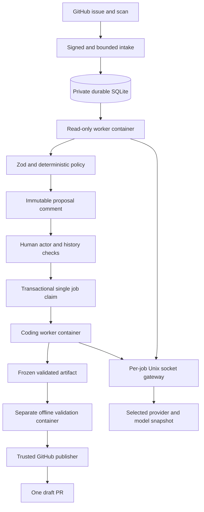

# Reina architecture and operations

## Terminology

The terminology reference is Reina's pinned `@earendil-works/pi-ai` **1.5.0** public types and
provider factories, plus the worker's Pi coding agent and agent-core **1.5.0** packages.
The SDK evidence is `dist/auth/types.d.ts`, `dist/models.d.ts`, `dist/types.d.ts`, and
`dist/providers/*.js` in the installed pi-ai package.
`scripts/prepare-worker.mjs` pins the worker; `src/agent/pi.ts` pins its CLI version and arguments.
The worker's packaged manifests, `dist/modes/interactive/interactive-mode.js`, and
`dist/modes/interactive/components/oauth-selector.js` confirmed the 1.5.0 selector wording.
The cached worker image was inspected without starting it. Global Pi **1.5.2** is
comparison evidence only; the local Pi checkout **0.84.4** and reference SDK **1.3.0** are not
authorities for Reina.

- **Provider** means the SDK `Provider`: it owns model catalogs, authentication, and request
  behavior. Its `id` is the SDK identity. A Reina **saved connection** is a separate configuration
  record: `SavedProvider.id` is its UUID, and `SavedModel.providerId` refers to that UUID.
  `sdkProviderId` identifies its built-in SDK provider. Multiple saved connections can use one
  SDK provider without sharing credentials.
- **Configure provider** starts credential setup for a built-in provider; it does not register a
  new SDK provider. **Select provider** is the picker, **Update credential** replaces a credential,
  and **Add custom provider** creates a custom connection. **Built-in provider** is the interface
  descriptor; SDK names such as **OpenAI Codex (legacy)** remain unchanged.
- **Select authentication method** offers **Sign in with an account** and **Sign in with an API
  key** by default. Provider-specific actions use SDK `OAuthAuth.loginLabel` when present. SDK
  provider `name` and authentication-method `name` are distinct labels, not aliases. For example,
  **Kimi For Coding**, **Kimi Code (subscription)**, and **Sign in with Kimi Code** have different
  roles. `authMethods` retains SDK `AuthType[]`; `SavedProvider.authType` directly reuses SDK
  `AuthType` rather than duplicating its literal union. Additive, read-only `authDetails` projects only
  supported methods' explicit `name`, `loginLabel`, and `isSubscription` metadata. Whole SDK auth
  objects, functions, credentials, and request auth must not be sent to the client for labels.
- **Account** and **API key** are user-facing method categories; **OAuth** is the technical
  mechanism. `oauth` and `api_key` remain SDK discriminators. **Subscription configured** requires
  SDK `isSubscription === true`; otherwise an OAuth credential is **Account configured**.
  API-key credentials are **API key configured**; absence is **Not configured**. The pinned CLI's
  `getLoginProviderOptions()` converts a missing subscription flag to `false` before its selector
  formatter runs. These statuses report local configuration, not verified authentication,
  entitlement, compatibility, or billing acceptance; they must not imply **Connected** or
  **Verified** merely because a credential exists.
- **Credential** is the stored SDK `ApiKeyCredential | OAuthCredential`. **ModelAuth** is resolved
  authorization for a model request (`apiKey`, `headers`, `baseUrl`), not the stored refresh-token
  record. Only the trusted host resolves it.
- **Select model** stores the **Selected model** preference. **Saved models** and **Save model**
  refer to Reina configuration records. Saving a model or credential does not select a model;
  selection does not prove that a running worker has applied it. Runtime application status is
  separate.
- **API** is the SDK `Model.api` identifier for the wire protocol, not a provider identity or
  endpoint. Keep **Base URL**, **Model ID**, **Display name**, **Context window (tokens)**, and
  **Maximum output tokens setting** for their respective fields. The last is `maxTokens`, not a
  universal enforced cap: SDK 1.5.0 ignores it for Codex. The Codex warning and request, byte, and
  time budgets below remain unchanged; these budgets are not upstream token or billing caps.
- **Pi coding agent** means the CLI; **agent** means agent-core behavior. The **Reina controller**
  is the trusted workflow service; a **worker** is an isolated execution container. A Reina
  **job** or approval **proposal** is not a Pi agent turn or message. A **Reina session** grants
  administration; it is not a Pi conversation session or a provider authentication flow.
  Stored `toolCall` and `toolResult` protocol values retain their spelling.
- **Thinking level Off** describes the worker's `--thinking off` setting. It does not promise
  that provider reasoning is disabled. **Reasoning** remains valid for native model capabilities
  and provider content.
- **Remove credential** removes local provider authorization, not the saved connection, Pocket ID
  access, or necessarily the provider's token. It does not claim provider-side token revocation.
  **Logout** deletes only the local Reina session, not the Pocket ID session or provider credential.

These wording and read-only presentation-metadata changes do not change API paths, JSON field
names, SDK IDs, auth discriminators, database schemas, environment variables, provider capabilities,
authentication or refresh, approvals, security limits, runtime behavior, or dependency versions.

## Boundaries

The management listener serves the admin UI and webhook intake on `127.0.0.1:36816`.
The TLS reverse proxy exposes `https://reina.narumi.dev` and must preserve `Host`.
Pocket ID OIDC authenticates administrators; `OIDC_ALLOWED_GROUPS` authorizes access through
comma-separated, exact Pocket ID group **Name** values. Matching is case-sensitive; any matching
group grants full administration. The default is empty, which locks login; there is no automatic
`user` administrator group.
See [Admin Web UI](admin-webui.md) for bootstrap, onboarding, and credential recovery.
Missing identity settings lock login. Missing dispatch configuration leaves the UI available
but keeps jobs stopped and webhooks at HTTP 503. `/healthz` checks HTTP readiness only.

Probot receives signed webhooks and supplies Octokit and structured logging. The HTTP entrypoint
bounds payloads and removes issue/comment content before Probot dispatch. A synchronous SQLite
write precedes acknowledgement. An in-process dispatcher performs asynchronous work after intake.

Target content, model output, commands, and test output are untrusted. They cannot mint approvals,
alter job records, provide GitHub credentials, select publication destinations, or declare a patch
validated. The trusted worker calculates the diff and records the actual verification exit codes.

All untrusted execution uses non-root Linux containers with no network interface other than
loopback, a read-only root filesystem, no capabilities, no-new-privileges, and seccomp. The only
model connection is an exact per-job Unix socket mount. A trusted loopback bridge forwards to the
host gateway. Only the trusted host resolves request authorization through SDK `Models.getAuth()`
and `ModelAuth`, including provider headers and credential-specific endpoints. The gateway accepts
only the selected model snapshot. Workers receive neither credentials nor native signed/reasoning
continuation metadata; host-only continuation state preserves SDK tool-call semantics.

The controller supports `openai-completions`, `openai-responses`, `anthropic-messages`,
`google-generative-ai`, and the distinct `openai-codex-responses`. Built-in models retain their
SDK protocol, endpoint, headers, and compatibility data, including mixed-protocol providers.
Dynamic Copilot destinations are restricted to the SDK's public
`api.individual.githubcopilot.com`, `api.business.githubcopilot.com`, or
`api.enterprise.githubcopilot.com` endpoints; Enterprise account login is not enabled. The first
resolved destination is pinned for that runtime resolver. Credential-bearing model requests require
public HTTPS, connection-time DNS validation, and no redirects. Auth failure does not fall back
to another account, API key, provider, environment variable, command, or host credential file.

Requests use text and tools only; the Pi coding agent uses thinking level Off. This does not
promise that provider reasoning is disabled. Other supported SDK adapters apply
an output cap of 4,096 tokens or the lower saved limit. **Codex exception:** SDK 1.5.0 ignores
`maxTokens` and omits `max_output_tokens`. Reina does not inject unsupported wire fields, so an
exact upstream 4,096-token cap is neither enforced nor claimed for Codex. Request-count, body-size,
response-byte, and time budgets still apply, but are not token or billing caps. Production Codex
use requires owner-authorized bounded live acceptance of this limitation. The static SDK catalog
and a configured credential do not establish remote authentication, entitlement, or compatibility.
Repository code can use the expiring job capability, subject to the same budgets as Pi.
Host Docker proxy variables are explicitly cleared so client configuration cannot inject proxy
credentials into a job. Startup probes verify this rule as well as the filesystem and process limits.

Triage uses a read-only snapshot mount. Coding uses a bounded disposable workspace volume.
Before export, the worker pauses the complete container, including detached children. The daemon
exports the frozen tree; the trusted parser rejects unsafe paths and unsupported file types.
A fresh offline container runs approved verification argv against the candidate. The published
artifact is separate from the validation workspace and includes a verification-bound digest.

Dependency preparation is separate from jobs. Only exact HTTPS registry.npmjs.org tarballs from
the approved npm v3 lockfile are fetched, size-bounded, and SHA512-checked. Package installation
runs offline with lifecycle scripts disabled inside a disposable container. Exported dependency
paths and links are constrained to the dependency subtree before a prepared image is built.

A container is a security boundary, not proof against a kernel/runtime vulnerability. Use a patched,
dedicated runner host. Never grant jobs privileged mode, host namespaces, a Docker socket,
unrestricted host directories, upstream API keys, App keys, or GitHub write credentials.

Publication can trigger target CI even for a draft PR. The target owner must ensure bot refs use
only disposable runners without secrets, write tokens, privileged execution, or deployment access.
Reina cannot enforce another CI system's isolation. Do not enable live publication until this
external security prerequisite is verified.

## Limits and supported targets

| Control                       | MVP limit                                                                        |
| ----------------------------- | -------------------------------------------------------------------------------- |
| Deployment                    | One service instance, enabled repository, and coding job                         |
| Scan                          | Default 15 minutes; at most ten candidate issues per pass                        |
| Issue context                 | 100 comments and 128 KiB; excess causes deferral                                 |
| Source                        | 2,000 regular files, 1 MiB per file, 16 MiB total                                |
| CPU / memory / processes      | One CPU / 2 GiB with no extra swap / 128 processes                               |
| Workspace / temporary storage | 256 MiB quota volume / 64 MiB tmpfs                                              |
| Time                          | Triage 120 s; coding at most 600 s; validation 180 s                             |
| Model requests                | Eight triage or 24 coding requests; 1 MiB/request; 4 MiB response; 60 s/request  |
| Model output                  | At most 4,096 tokens with supported non-Codex SDK caps; no exact Codex token cap |
| Pi output                     | 1 MiB/JSONL record; 8 MiB stdout; 64 KiB stderr                                  |
| Patch                         | Ten files and 64 KiB unified diff; configured limits can be lower                |
| Approval                      | Exact revision and base; expires after 24 hours; one coding invocation           |
| GitHub reads                  | Initial read plus at most three transient retries; rate-limit deferral           |
| Persistent inbox              | Delivery deduplication; at most eight deferred attempts                          |

Only Node/npm regular-file Git trees are supported. Symlinks, submodules, workspaces, external
package sources, binary patches, mode changes, and dependencies that need lifecycle scripts are
rejected. Paths are also limited to 240 UTF-8 bytes and exports to 4,001 archive entries.
Preparation permits 2,000 packages, 32 MiB per tarball, 128 MiB total downloads, and 192 MiB of
exported dependencies, with a 600-second overall deadline. Resource or dependency failures do not
enable broader access. Linux cgroup v2, built-in seccomp, local tmpfs volumes, and Docker Unix
socket binds are required. Build-time transitive OS/npm packages are resolved during preparation;
the approved immutable image binds their actual contents. Remote Docker daemons and Docker Desktop
are unsupported by this deployment layout. OrbStack is unverified.

Identical assessments, including failed or deferred ones, run at most once per UTC day for each
issue-content/base/policy key. A changed key permits a new assessment. State-only reopening or
removing an exclusion can therefore wait for the next assessment day. Scans use a durable page
cursor so skipped or previously assessed issues do not permanently hide older issues.
Oversized or changing issue evidence is deferred for that issue only. The scan can process other
issues and advance its cursor. No incomplete evidence is sent to triage. Real GitHub rate limits
and exhausted transient reads still apply a persistent global cooldown. Before a job is claimed,
a temporary comment-count mismatch retains its delivery for issue-local retry after 15 minutes.
The signed approval action stays available for fresh authorization. Local retries use the same
eight-attempt limit.

After a job is claimed, incomplete issue evidence stops a pre-publication attempt as `failed`.
The approval remains consumed, and `bot:failed` remains its state projection. Another coding
attempt needs a new human approval transition. A `publishing` job keeps its artifact and uses
publication recovery without another coding run. Both paths emit info-level `execution_deferred`,
not `execution_failed`. Issue-local limits do not set a global cooldown.

The patch allowlist is further narrowed by the proposal's exact file list. Hard exclusions cover
credentials, agent instructions/configuration, workflows, dependencies, tooling, and deployment.
Operators must identify the target's security-sensitive source domains. Path checks cannot prove
semantic safety; uncertain assessments are deferred and every draft still needs human review.

## Admin settings and runtime snapshots

The authenticated UI accepts an unencrypted RSA PEM App key (at least 2048 bits, at most 32 KiB)
and typed `api_key` or `oauth` provider credentials. AES-256-GCM encrypts complete SDK credentials,
including OAuth access/refresh tokens and provider-specific fields, in private `settings.sqlite`
next to the job database. `ENCRYPTION_KEY` remains outside the database. Settings expose only
presence flags, metadata, and the App public-key fingerprint. Setup exposes bounded prompts,
verification links/user codes, progress, and results, never credential objects or raw SDK errors.
Credentials and native continuation secrets never enter workers, job/proposal records, logs, or
browser localStorage/sessionStorage. Newly submitted keys and manual codes exist briefly in
browser memory. Sessions have an eight-hour maximum lifetime and store a hash of the bearer
token, not the token itself.

Provider setup is method-first: account or API key, then provider search, then SDK-owned prompts.
Only the explicit custom API-key path uses a generic endpoint/protocol/key form. Account support
is limited to `openai-codex` device code, `anthropic` copy/manual code, and device flows for
`github-copilot`, `kimi-coding`, `meta`, and `xai`. Copilot is public `github.com` only and requires
separate explicit consent before SDK login can enable model policies remotely. Catalog listing
never starts login or changes policies. The server fixes headless SDK choices; there is no new
callback listener/port, browser token store, custom token exchange, or host Pi auth import.

The SDK's callback-based OpenAI ChatGPT and OpenRouter account methods are not exposed. Their
API-key methods remain available where models fit supported SDK protocols. OpenAI API-key access
is not OpenAI Codex account authorization. Radius uses unsupported `pi-messages` and is excluded.
Pocket ID authenticates Reina administrators; provider OAuth is a separate authorization boundary.

An opaque setup flow belongs to its initiating Reina session. Mutations require exact Origin and
CSRF validation; cross-session access and stale prompt responses are rejected. Memory-only flows
expire within 15 minutes, with at most 64 total and four active flows per session owner. Cancel,
expiry, owner logout/session invalidation, and shutdown abort pending SDK work; stale replies
cannot advance login. Login writes are staged and commit atomically only while the owner and
expected credential generation remain valid. Failed or late setup cannot replace prior credentials,
models, or selection. Setup success never selects a model.

OIDC requests `openid profile groups`. Authorization uses only a bounded string array in the
verified, signed ID-token `groups` claim, matched against configured group names. Subject, email,
user name, group UUID, and **Friendly Name** values do not authorize administration. `sub` remains
session identity only; userinfo is not an authorization fallback. The official
[Pocket ID claim documentation](https://pocket-id.org/docs/guides/scopes-and-claims) describes group
**Name** arrays in ID tokens and userinfo, but describes unreleased behavior. The client owner must
confirm actual deployed ID-token claims with OIDC Data Preview; do not probe public services.

Settings schema 3 adds SDK provider identity, typed encrypted credential envelopes, and logical
credential generations. Migration transactionally wraps legacy API keys and preserves providers,
models, active selection, the saved App PEM, and schema-2 sessions. The earlier schema-1 group
migration still adds `sessions.groups` and removes sessions without verified groups. Migration
or encryption-key failure rolls back the transaction. Keep the original `ENCRYPTION_KEY`.
The separate job database schema is unchanged by provider authentication.

Each saved Reina connection has an isolated SDK `CredentialStore`, even for the same SDK provider.
`Models.login()` writes into staging; `Models.getAuth()` resolves and refreshes request auth only
on the host. SDK credential modifications serialize per connection; UI replacement and removal
atomically invalidate the old generation. Rotated tokens are persisted atomically with a compare-and-swap check on the logical generation and credential
type, without holding a SQLite transaction across network requests. Replacement/removal changes
the generation, so a late refresh cannot overwrite a new login or restore deleted credentials.
Failed refresh preserves the stored credential and stops the request with a safe reconnect error.
Refresh within an unchanged generation does not change `modelRevision` or approval authority.
Model eligibility is checked against the refreshed credential. Shutdown stops auth admission and
drains started credential mutations before closing SQLite, so cancellation cannot discard a rotated
token that the provider has already issued.

SDK authentication traffic uses an async-context-scoped Undici dispatcher. Unscoped host traffic
keeps its original transport. Scoped traffic permits only fixed provider HTTPS hosts, methods, and
paths, including Copilot token-derived model/policy requests. The auth transport rejects redirects
and compressed responses, checks public DNS at connection time, and enforces body, header, time,
and request-count bounds. Each response is at most 1 MiB, each request body at most 64 KiB, and
each request at most 30 seconds. API-key-only providers have no outbound auth routes. Model
inference retains its separate bounded transport. No SDK process-global fetch replacement occurs.

A successful settings mutation disables dispatch, stops active jobs, and rebuilds an immutable
controller configuration snapshot. Explicit selection stores one saved connection/model preference;
no model is selected merely by saving a credential or model. The preference is not proof that
configuration is applied to a running worker; inspect runtime status separately. Removing a credential retains saved models
but clears selection if it uses that provider. Deleting the selected model or provider also clears
selection. Removal stops affected work; local deletion does not prove provider-side revocation.
No automatic paid provider connection test runs. Local configured status is not remote verification.
Environment changes require a restart. The authentication-context digest includes the issuer,
client ID, public origin, and allowed group list. Changing any of these invalidates all stored
sessions at startup. Each authenticated request checks configured groups against stored login-time
groups. Logout affects the local Reina session only, not Pocket ID.

Removing Pocket ID group membership does not immediately revoke an existing Reina session.
There is no live membership refresh or back-channel logout. The next login reads membership again.
Sessions expire at most eight hours after login; further access requires a new login. A restart
with an unchanged authentication context does not refresh membership. This revocation limit
remains an operational constraint.

A cleanup failure latches dispatch stopped with `cleanup_requires_operator_check`. A UI reload
cannot clear that condition. The operator must inspect cleanup and restart; never relax sandbox
controls or clear job records to make configuration apply.

## Approval and state

The proposal hash binds repository/installation/issue IDs, material issue content, base name/SHA,
behavior, exact files, verification argv, policy (including model configuration revision), image
identity, and expiry. `modelRevision` includes the selected model snapshot and logical credential
generation. Credential replacement changes that revision and requires a fresh proposal and human
approval; normal OAuth refresh within the unchanged generation does not. A job cannot silently
switch accounts or destinations. Reina's own comments, labels, reactions, and `updated_at` do not
invalidate the proposal. Other comment changes are material.

Approval requires a signed label event from a human, live repository permission, an identifiable
current label-history transition after the exact proposal comment, and no conflicting job or PR.
Reina checks that the App-owned proposal comment still has its immutable content. Presence of
`bot:approved` alone is never authority. Delayed events cannot approve a later proposal.
Observed close/reopen history also revokes proposals created before that lifecycle change, even
when those webhooks are missing. Accepted revocation and inbox state commit in one transaction,
so a crash cannot restore authority before publication recovery.

SQLite stores proposals, consumed approval events, inbox deliveries, jobs, and publication phases.
It uses foreign keys, WAL, full synchronous durability, and an independent process-lifetime
SQLite lock. The OS releases that lock after a crash. The directory is service-owned and private.
Ephemeral storage, network filesystems, and multiple service instances are unsupported.
Schema version 4 stores global cooldowns separately from local delivery deadlines. The transactional
upgrade preserves existing cooldowns from schema versions 1, 2, and 3. Stop the service and take a
consistent backup before an upgrade.

Normal job states are approved, working, validating, publishing, and pr_ready. Failed and
cancelled jobs cannot resume coding. The public labels are projections of state:

| Label           | Meaning                                                                 |
| --------------- | ----------------------------------------------------------------------- |
| `fix_available` | A current feasible proposal exists                                      |
| `bot:approved`  | A human added an approval transition; the record still needs validation |
| `bot:working`   | Coding, validation, or publication is in progress                       |
| `bot:pr_ready`  | A confirmed draft PR exists                                             |
| `bot:failed`    | An attempt failed or publication needs recovery                         |
| `bot:skip`      | Maintainer-controlled exclusion; Reina never removes it                 |

Live GitHub checks occur immediately before execution and publication. Received revocations,
material edits, closure, and access loss cancel pending work and interrupt running containers.
GitHub observations, webhook delivery, and local transactions are not atomic. A remote change
can race the last check; there is no claim of instantaneous distributed revocation or exactly-once
remote transactions. A base change does not authorize an automatic rebase.

Shutdown aborts active worker signals and prevents new claims, triage, coding, and publication
recovery. A delivery stopped before dispatch stays in the durable inbox. A later service instance
must check its evidence and authority again.

## Publication and recovery

Only the trusted GitHub boundary obtains narrowly scoped installation write tokens.
Read-only clients receive read permissions and both clients are limited to the configured numeric
repository ID. Renewals request fresh scoped tokens rather than reusing Octokit's longer cache.
Automatic Octokit throttling/retry is disabled; boundaries control retries. Persistent global
cooldown applies before further GitHub job/scan work, including write responses and reconciliation
reads. A deleted terminal issue cannot prevent other publication jobs from recovering.

The publisher uploads validated blobs, trees, commits, and a new ref through GitHub APIs.
It never runs Git or hooks with credentials. The branch is `narumi/fix/reina-issue-<number>`.
Commit inputs are stable, and publication intent/resource IDs are persisted before later effects.

Unknown write responses require reconciliation. The publisher compares the exact ref/commit and
App-owned PR marker, head, base, and author across all PR states. Existing closed or merged PRs
are terminal. Unknown comment/PR creation with no conclusive result does not permit another POST.
An explicit rate-limit rejection with HTTP 403 or 429 can record a single-use retry deadline.
Intent stays recorded. After the deadline, the publisher reconciles first and consumes that retry
authorization in durable state before another POST. A lost retry response cannot reuse it.
Other responses, including HTTP 5xx with rate-limit headers, do not authorize a retry.
Conflicting resources are not overwritten, force-pushed, reopened, or deleted.

On restart, the service terminates its own orphan containers, volumes, and private staging directories,
revokes local capabilities, and
fails interrupted approved/working/validating jobs. Publishing jobs are reconciled using their
stored artifact and fresh authorization without repeating coding. If authorization expired or
changed, do not resume remote writes. Existing remote effects require operator review.

### Operator actions

1. Stop the service before changing state or restoring a backup. Confirm its labelled job
   containers and volumes are removed. Do not remove unrelated containers or images.
2. Back up both job state and `settings.sqlite` consistently with Node's `node:sqlite` backup API
   or a stopped-store backup that includes the WAL state. Never copy only a live main database file.
   - Securely retain the original `ENCRYPTION_KEY` separately from the state backup. Key loss makes
     encrypted App and provider credentials undecryptable.
   - There is no built-in key rotation. Do not blindly regenerate the key; replacing the environment
     value does not re-encrypt existing state. See [credential recovery](admin-webui.md#secret-storage-and-recovery).
3. Version and restore the application, compatible databases, and original encryption key together.
   A downgrade after settings schema 3 requires the matching pre-upgrade backup; do not delete
   OAuth rows or columns by hand. Restored backups can restore old provider credentials and
   sessions. Revoke affected sessions and review provider authorization before enabling dispatch.
   Do not clear approvals, inbox IDs, or publication intents to make a retry succeed.
4. If state is lost or corrupt, keep dispatch stopped. Restore a backup and reconcile GitHub
   branches/PRs before enabling work. Labels cannot reconstruct authorization.
5. For an interrupted coding attempt, inspect its failure and have a maintainer remove/re-add
   approval only if the proposal is still current. Otherwise wait for a new proposal.
6. For unknown publication, inspect the stored intent and matching GitHub resources. Do not
   delete a branch/PR or reset an intent without explicit maintainer authorization.
7. On rollback, stop scans/dispatch, cancel workers, preserve resource IDs, and restore a compatible
   application. Older binaries cannot open schema version 4 or read the optional retry deadlines.
   Restore a matching state backup before using an older version. Do not automatically close
   existing PRs or delete branches.

Logs include event, repository ID/name, issue, installation, job/proposal, and correlation IDs.
They use reason codes instead of raw API/model errors. Do not enable raw Probot debug payload
logging or post private test output to GitHub.

Job and delivery failures (`failed`, `execution_failed`, and `recovery_failed`) use `error` level.
Normal lifecycle, deferral, and cancellation events use `info` level. A cancelled delivery emits
`cancelled`, including an interrupted triage assessment. An interrupted or revoked execution emits
`execution_cancelled`. The original execution failure is logged before label updates, so a failed
notification cannot hide its job ID and reason.

Runtime startup logs preserve explicitly allowed identity, Docker, and worker failure codes.
Unknown errors use `authentication_or_sandbox_unavailable`; raw messages, stacks, and causes are
not logged. Failed startup cleanup emits `runtime_stop_failed` with
`cleanup_requires_operator_check` and keeps dispatch stopped.

Unexpected administration and HTTP handler failures emit `http_request_failed` with a fixed
reason, response status, allowed HTTP method, and allowed route or route template. Unknown
methods and routes use a fixed marker. Logs exclude request bodies, headers, cookies, query
strings, and raw errors. Expected validation/authentication responses, health checks, and webhook
503 responses while dispatch is not configured do not emit error logs.

For `runtime_timeout` or `pi_*`, inspect the phase and job ID, check provider/worker availability,
and obtain a fresh human approval before another coding attempt. For `verification_failed`,
use the recorded exit codes and approved commands to reproduce inside the offline worker, never
on the control-plane host. For `worker_dependency_fingerprint_mismatch`, prepare an image matching
the approved manifests; the changed image needs a new proposal. Unknown GitHub write outcomes
require the reconciliation steps above, not a reset of job state.

## Verification and external acceptance

Credential-free unit/webhook tests and real Pi/container checks verify the implemented boundaries.
A local protocol fixture does not verify a paid provider, real App permissions, live webhook
delivery, semantic model quality, target CI safety, or production-host isolation. Runtime tests
exercise CPU throttling, process exhaustion, storage quotas, network denial, read-only mounts,
Pi tool calls, detached-process freezing, and timeout cleanup. They inspect the enforced 2 GiB
memory cgroup but do not perform a 2 GiB out-of-memory stress test.

### Verification commands

Run checks against the current revision; this document does not report final test counts or
claim that the admin UI has live acceptance.

| Check                              | Scope                                                                     |
| ---------------------------------- | ------------------------------------------------------------------------- |
| `npm run ci`                       | Biome, credential-free Vitest tests, and TypeScript build                 |
| `npm run check:changesets`         | Changesets metadata for normal pull requests                              |
| `npm run test:runtime`             | Actual Docker/Pi/Compose boundaries; also required on the production host |
| `npm audit --audit-level=moderate` | Reported project dependency vulnerabilities                               |

Real App/OIDC/provider/deployment acceptance requires the owners below. The 2 GiB out-of-memory
stress test is not included; runtime checks inspect the enforced cgroup memory limit.

The runtime checks include host-proxy credential exclusion and scoped orphan staging cleanup.
The Compose check builds the controller image, prepares an isolated worker, exercises the shared
snapshot and Unix socket mounts with actual Pi triage, and checks SQLite state across controller
recreation. It uses fake credentials and a local model fixture, not a live App or paid provider.
Changeset Markdown formatting is disabled at the narrow `.changeset/*.md` scope because the
current formatter rewrites YAML frontmatter as Markdown. `check:changesets` validates that metadata.
CI runs this check only for pull requests other than the generated `changeset-release/main` release PR.

TypeScript remains strict for application sources. `skipLibCheck` avoids the current
`pino-http@11` / `@types/node@26` declaration-augmentation incompatibility. It does not disable
application type checking. Recheck this workaround when upgrading Probot or Node types.

### External acceptance owners

1. **App owner:** register and install the App, create all six label definitions, and confirm
   minimum permissions, subscribed events, installation authentication, and signed delivery.
   Supply App credentials securely; upload the PEM through the authenticated UI.
2. **Pocket ID account owner and realm operator:** configure the confidential client, exact
   callback, `openid profile groups` scopes, allowed group **Name** values, DNS, TLS, and
   Host-preserving proxy. Confirm deployed signed ID-token groups with OIDC Data Preview; public
   unreleased documentation is not deployment evidence. Verify authorized and denied login, and
   retain the session revocation limit above. Follow the
   [admin smoke check and handoff](admin-webui.md#operator-smoke-check-and-external-handoff).
3. **Model account owner:** verify actual authorization, MFA where required, live entitlement,
   reconnect, cancellation, and token rotation with a supported account. Confirm Copilot's remote
   policy-change consent. Separately authorize bounded paid inference with the test-repository
   maintainer; verify the selected API/model, streaming/tool continuation, supported output caps,
   quality, and billing. Codex requires explicit acceptance of SDK 1.5.0's unenforced upstream token
   cap; byte/time/request budgets are not a 4,096-token or billing guarantee. Never request tokens
   or codes in chat. Configured credentials and fixture tests do not close this production gate.
4. **Deployment operator:** provide private persistent storage, pinned images, and a patched Linux
   host with the required local Docker controls. Review pre-upgrade backups, WAL state, the original
   encryption key, and restoration before migration. Run the runtime suite on that production host;
   local success does not establish production isolation. The existing macOS/OrbStack preflight
   failures also occur at the unmodified baseline boundary and remain a release restriction, not
   runtime acceptance. Missing controls keep execution stopped.
5. **Repository maintainer:** confirm bot-triggered CI uses disposable runners without secrets,
   write tokens, privileged containers, or deployment access. Authorize a fresh test-repository
   issue, review its proposal, add a new human approval, and inspect the resulting draft PR.
   Check denied approval, revocation, failure, and restart recovery. Expect no duplicate job/PR,
   no merge, and no auto-merge. The MVP is not live-accepted until these external checks pass.

No live App registration, paid inference, deployment, package publication, version tags, or release
workflow dispatch is part of credential-free implementation validation.
